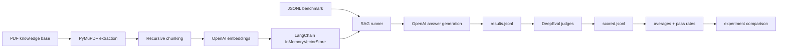

# RAG Evaluation Lab

A portfolio-ready evaluation system for PDF-based Retrieval-Augmented Generation (RAG), inspired by AI Career Lab's [DeepEval project walkthrough](https://www.youtube.com/watch?v=UhILMAhpxFQ&t=1565s).

It separates retrieval, answer generation, judging, aggregation, and experiment comparison so each stage can be tested and replaced independently. The repository includes a 20-question penguin benchmark and a deterministic offline path that runs without API calls.

## What it measures

| Metric | Question answered | Live implementation |
|---|---|---|
| Answer relevancy | Does the answer address the question? | `AnswerRelevancyMetric` |
| Faithfulness | Is the answer supported by retrieved context? | `FaithfulnessMetric` |
| Contextual relevancy | Did retrieval return useful evidence? | `ContextualRelevancyMetric` |
| Correctness | Does the answer agree with the expected answer? | DeepEval `GEval` |

## Architecture



The offline smoke path replaces OpenAI retrieval/generation and LLM judges with transparent lexical adapters. It verifies plumbing and reproducibility; its scores are **not** substitutes for DeepEval scores.

## Quick start

Requirements: Python 3.12 or 3.13 and [uv](https://docs.astral.sh/uv/).

```bash
uv sync --extra dev
uv run rag-eval demo \
  --pdf data/penguins.pdf \
  --dataset data/eval_dataset.jsonl \
  --output-dir artifacts/offline-k3 \
  --experiment offline-k3 \
  --k 3 \
  --chunk-size 450 \
  --chunk-overlap 60
```

This creates:

- `results.jsonl` — question, expected answer, actual answer, retrieved context, and run metadata
- `scored.jsonl` — per-case metric scores, pass flags, and reasons
- `summary.json` — metric averages and pass rates

## Run the live OpenAI + DeepEval workflow

Copy `.env.example` to `.env` and set `OPENAI_API_KEY`. Live generation and evaluation make paid model calls.

```bash
# 1. Build the in-memory vector store and generate answers
uv run rag-eval run \
  --pdf data/penguins.pdf \
  --dataset data/eval_dataset.jsonl \
  --output artifacts/live-k3/results.jsonl \
  --k 3 \
  --chunk-size 450 \
  --chunk-overlap 60 \
  --embedding-model text-embedding-3-small \
  --chat-model gpt-4o-mini

# 2. Judge every case with DeepEval
uv run rag-eval evaluate \
  --input artifacts/live-k3/results.jsonl \
  --output artifacts/live-k3/scored.jsonl \
  --threshold 0.7 \
  --judge-model gpt-4o-mini

# 3. Aggregate averages and pass rates
uv run rag-eval summarize \
  --input artifacts/live-k3/scored.jsonl \
  --output artifacts/live-k3/summary.json \
  --experiment live-k3 \
  --threshold 0.7 \
  --k 3
```

## Compare experiments

Create another run with a different `--k`, chunk size, prompt, or model, then compare summaries:

```bash
uv run rag-eval compare \
  --summaries artifacts/live-k1/summary.json artifacts/live-k3/summary.json \
  --baseline live-k1 \
  --output artifacts/live-comparison.json
```

The comparison reports each experiment's average, pass rate, and score delta from the selected baseline. Configuration is stored in each summary so experiment labels cannot silently disagree with retriever settings.

## Included benchmark

- `data/penguins.pdf` — two-page sample knowledge base
- `data/penguins_source.txt` — editable source for the sample document
- `data/eval_dataset.jsonl` — 20 stable IDs, questions, and expected answers
- `artifacts/offline-k1/` and `artifacts/offline-k3/` — reproducible smoke outputs
- `artifacts/offline-comparison.json` — a checked comparison example

Current deterministic smoke comparison:

| Experiment | k | Answer relevance | Context relevance | Correctness | Faithfulness |
|---|---:|---:|---:|---:|---:|
| offline-k1 | 1 | 0.551 | 0.658 | 0.341 | 1.000 |
| offline-k3 | 3 | 0.568 | 0.745 | 0.423 | 1.000 |

These lexical scores only show that changing retrieval configuration changes measurable outcomes. Use the live workflow for semantic evaluation.

## Project layout

```text
src/rag_eval_lab/
  cli.py           # demo, run, evaluate, summarize, compare commands
  documents.py     # PDF block extraction and chunking
  rag.py           # dependency-injected RAG pipeline + OpenAI adapters
  evaluation.py    # DeepEval adapters and scoring orchestration
  experiments.py   # averages, pass rates, baseline deltas
  offline.py       # deterministic zero-cost smoke adapters
  models.py        # strict Pydantic artifact schemas
  io.py            # validated JSONL I/O
data/               # sample PDF and 20-case benchmark
tests/              # offline unit and end-to-end tests
artifacts/          # reproducible example outputs
```

## Quality checks

```bash
uv run pytest --cov=rag_eval_lab --cov-report=term-missing
uv run ruff check .
uv run ruff format --check .
```

The tests do not call external APIs. The CLI end-to-end test creates a PDF, retrieves context, generates an extractive answer, scores it, and verifies all three artifact types.

## Design choices

- **Dependency injection:** retrieval and answering protocols make the pipeline testable without mocks or API calls.
- **Strict schemas:** malformed JSONL and out-of-range metric scores fail early with useful errors.
- **No hidden import-time work:** embeddings and model clients are created only by explicit commands.
- **Reproducible experiment metadata:** `k`, chunk settings, threshold, and mode are saved with summaries.
- **Honest offline mode:** lexical metrics are clearly labeled as smoke checks rather than semantic judges.

## License

MIT
